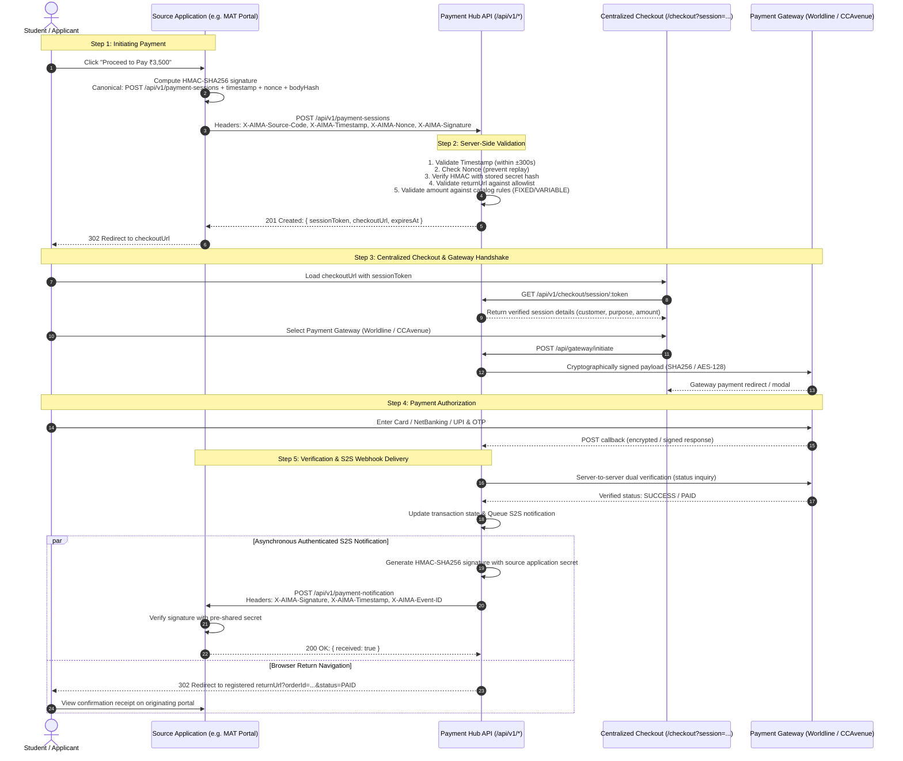
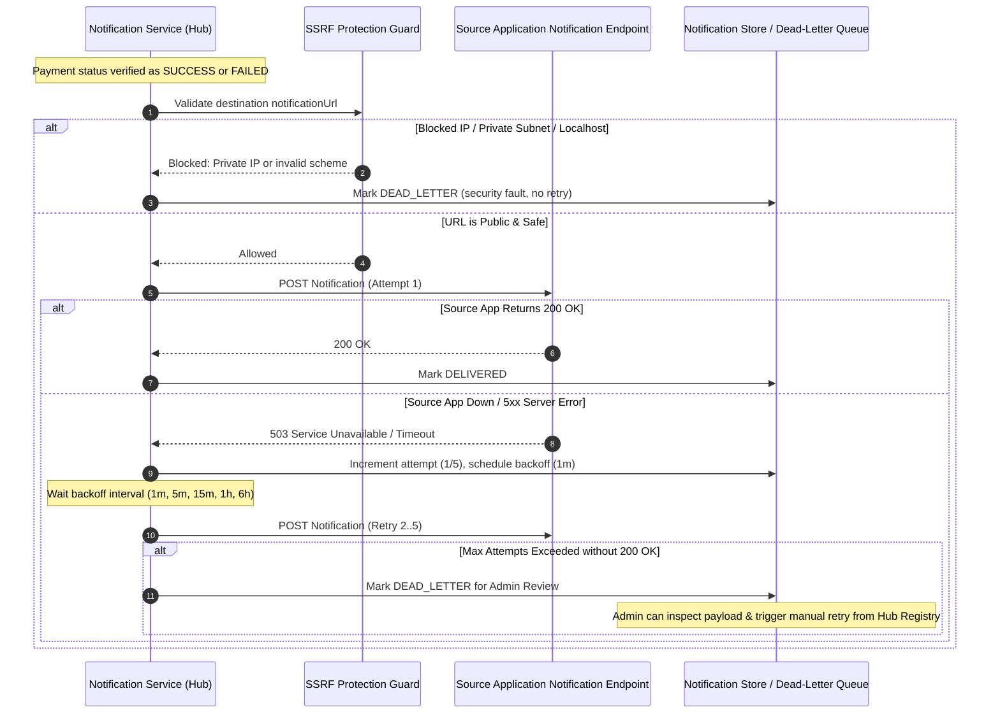
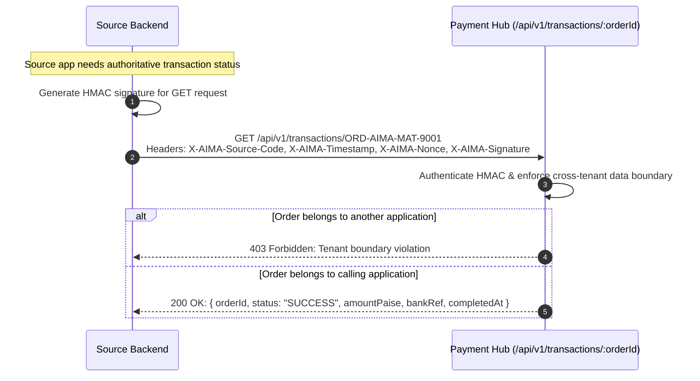

# AIMA Payment Hub — Phase 3 Integration Sequence Diagrams

This document contains visual architectural sequences for source applications integrating with the AIMA Centralized Payment Hub.

---

## 1. End-to-End Payment Session Flow

---

## 2. Server-to-Server Notification & Retry Mechanism

---

## 3. Real-Time Status Verification Polling (Source App Server)

